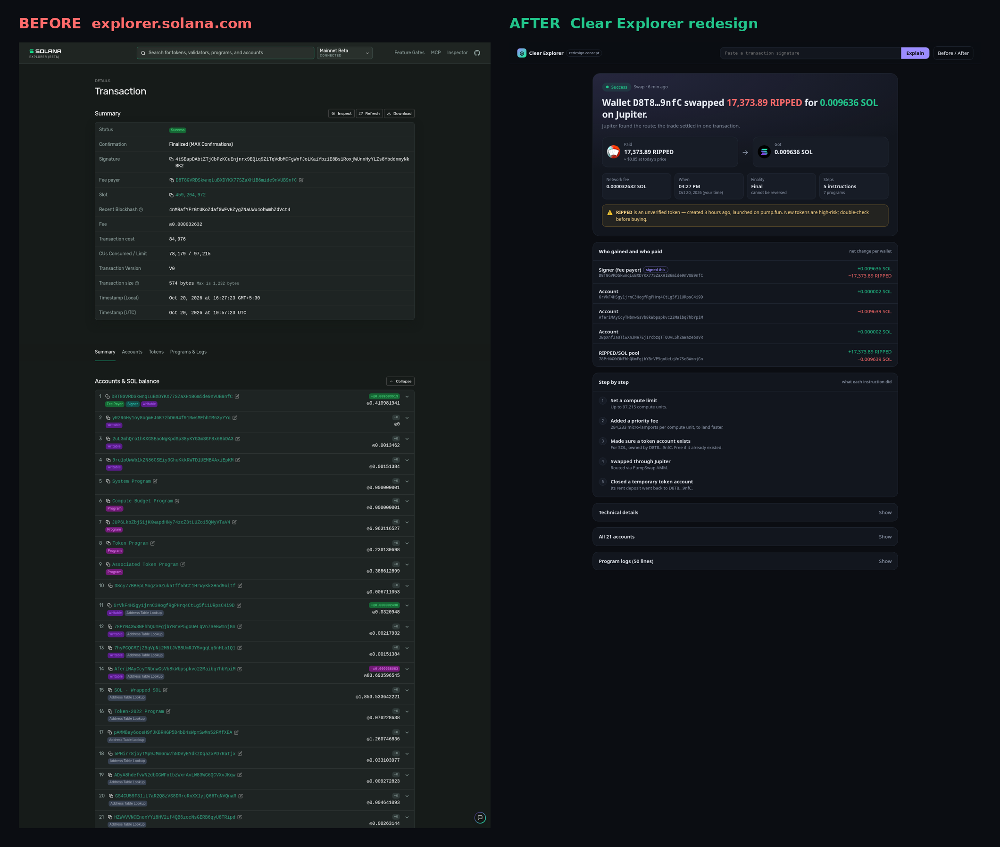
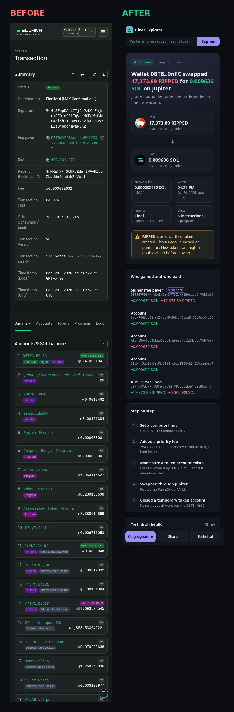

# Clear Explorer — redesigning the Solana Explorer transaction page

**App:** Solana Explorer (explorer.solana.com) · **Feature redesigned:** the transaction detail page (`/tx/<signature>`), plus its error states and the mobile layout.
**Live prototype:** <LIVE_LINK> — works on real mainnet transactions. Paste any signature.

## The problem

Every Solana user ends up on the Explorer. A wallet shows "Transaction sent ↗", a friend shares a link, support says "send me the tx". The Explorer opens with **15 rows of protocol data**: signature, fee payer, slot, recent blockhash, compute units, transaction version, size in bytes, two timestamps. Under that comes a list of **21 accounts** with lamport balances.

Nowhere does the page say **what happened**. In the sample transaction a wallet sold 17,373 RIPPED (a 3-hour-old pump.fun token) for 0.0096 SOL through Jupiter. To work that out on today's page you have to open the Tokens tab, match token accounts to owners, and know that the wSOL account that was created and closed counts as SOL. Most people can't, so they screenshot the page and ask on Discord or X.

On mobile it gets worse. The 88-character signature wraps over five lines, the key/value table breaks into narrow columns, and the useful parts (balances, programs) sit about four screens down.

## Who it's for

The 90% of visitors who are **not** developers: a new user checking that a swap went through, someone confirming they got paid, a person working out why a transaction failed. Developers still get every raw field, one tap away.

## Design decisions

| # | Decision | Why |
|---|---|---|
| 1 | **A one-sentence headline**: "Wallet D8T8…9nfC swapped 17,373.89 RIPPED for 0.009636 SOL on Jupiter." | It answers the question people came with in the first 2 seconds. It's generated from net balance changes for the signer, so it works for any program, not only known ones. |
| 2 | **Paid → Got cards** with token icons and the USD value labelled *"at today's price"* | People think in amounts and money, not lamports. The label is honest: it's the current price, not the historical one. |
| 3 | **Four fact tiles**: network fee (SOL + USD), local time, finality, number of steps | These replace the 15-row table. "Final · cannot be reversed" says in plain words what "Finalized (MAX confirmations)" means. |
| 4 | **Risk banner for new or unverified tokens** ("created 3 hours ago, launched on pump.fun") | The Explorer is where people check tokens they've just been sent or bought. A quiet warning at that moment protects new users, and it uses public token data. |
| 5 | **"Who gained and who paid"**: net change per wallet, wrapped SOL merged into SOL, pools named ("RIPPED/SOL pool") | This replaces the 21-row account list, where most rows changed by 0. Only accounts whose balance moved are shown. |
| 6 | **Step by step**: each instruction in plain English ("Added a priority fee: 284,233 micro-lamports per CU, to land faster", "Closed a temporary token account, its rent went back to you") | It teaches how Solana works while you read. Compute Budget data is decoded instead of shown as base58. |
| 7 | **Failed transactions explain themselves**: "The price moved more than your slippage setting allowed, so the swap was cancelled to protect you." | Today a failure shows `{"InstructionError":[3,{"Custom":6001}]}`. The redesign maps common errors (slippage, insufficient funds, compute exhausted, expired) to plain-language causes and what to do next. |
| 8 | **Raw data kept, but collapsed**: Technical details, All accounts, Program logs | Nothing is removed for power users. It's moved under progressive disclosure. |
| 9 | **Mobile-first actions**: a sticky bottom bar with Copy signature / Share / Technical, a full-width search, cards stacked vertically, and an arrow that rotates to point down | The main mobile jobs are "copy this", "send this to someone" and "show me the details". Each one is reachable with a thumb. |
| 10 | **Helpful empty and error states**: wrong input ("that's a wallet address, not a signature"), not found yet, RPC rate-limited | Today these states are dead ends. |

## Other states covered
- Failed swap (desktop): `site/assets/failed-desktop.png`
- Plain SOL transfer with a durable nonce (mobile): `site/assets/transfer-mobile.png`
- Invalid input (mobile): `site/assets/bad-input-mobile.png`

## How it's built
A static page (HTML/CSS/vanilla JS, no build step) that reads real data from Solana mainnet RPC (`getTransaction`, `jsonParsed`) and Jupiter's public token and price API. The headline logic: compute the net SOL change per owner (with the fee taken out) and the net token change per owner, merge wSOL into SOL, ignore rent dust, then classify the result as swap, transfer, received, failed or other. It also handles v0 and v1 transaction versions.
